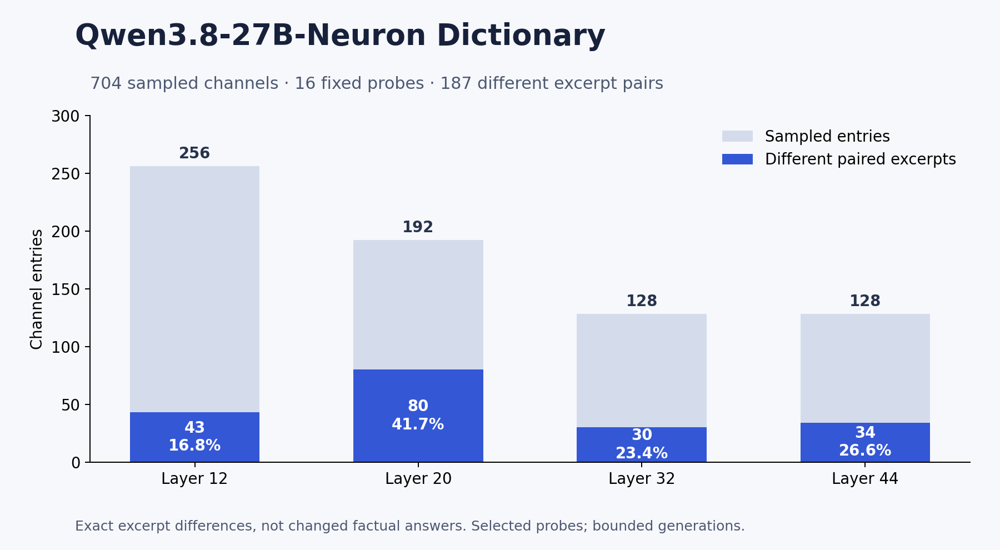

# Findings supported by this release

## Verified artifact findings

1. There are **704 unique sampled channel entries**, with one matching paired example each and no duplicate layer–neuron keys.
2. All **11,264 channel–probe effect cells** are recoverable from four raw JSON profiles. Entry summary magnitudes and concentrations agree within rounding; offsets agree with the corresponding calibration maxima.
3. **187/704 stored excerpt pairs differ (26.6%)**. By layer: 43/256, 80/192, 30/128, and 34/128. This is a descriptive count of this archive, not an estimated model-wide intervention success rate.
4. These examples include changes in formatting, preamble, and amount of explanation. A short example: the spider prompt at L20 N2302 changes from `A spider has **8** legs.  **Explanation:**` to `8`. Both excerpts contain the expected answer. See the full table rather than treating a selected example as representative.

## Interpretation

The dataset is useful for asking how additive MLP interventions alter token-level readouts and short continuations. It supports selecting hypotheses and reproducing interventions. It does not establish that a neuron “means” its largest-effect probe.

## Headlines withheld after audit

| Historical claim | Why it is withheld |
|---|---|
| An n^2.19 interaction law | The fit includes an artificial floor for an exactly zero size-one error; the exponent is floor-sensitive. |
| An 81% successful stopping rate | The original script counts shortening on four reused prompts; it does not preserve explicit stop reasons or completed-answer quality. |
| Every dictionary row is verified out of sample | The verification strings were copied from selected layer-level tests. |
| Broad factual enhancement or “knowledge preserved” | Immediate target-token likelihood and substring matches do not establish correctness or retained knowledge. |
| A general saturation mechanism | Signed gate behavior and confounded rescalings do not identify that mechanism. |
| A knowledge/reporting dissociation on Qwen3.8-27B | The recent experiment was on Qwen2.5-7B and uses limited confidence and answer-presence proxies. |

These exclusions are deliberate. A polished release should not turn exploratory interpretations into verified findings.

## Fresh example replay

Six preselected entries spanning all four sampled layers were re-run on the authenticated checkpoint with an NVIDIA B200. All six baseline and all six intervention excerpts matched the archive under the historical 12-token generation cap. Full generated token IDs, text, and explicit EOS classifications are included in `evidence/example_replay.json`. Additional 96-token continuations are retained to make the short-window limitation inspectable.

The spider example at L20 N2302 reproduced `8` under the intervention; its baseline still had not stopped at the 96-token cap. Both contained the expected answer. This demonstrates a change in continuation and length for that prompt; it does not establish an improved answer, a specialized “spider neuron,” or a general stopping circuit.

